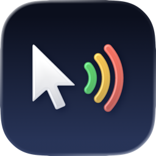
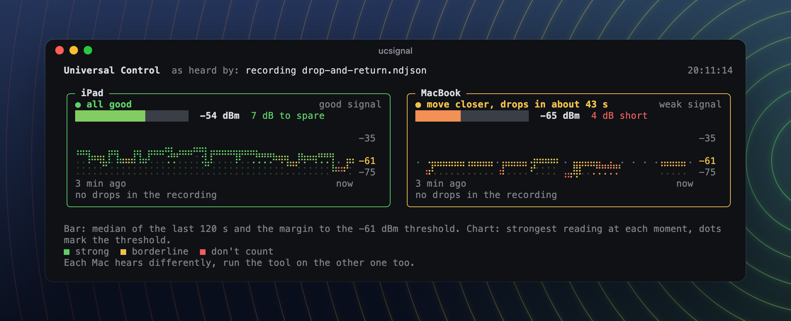
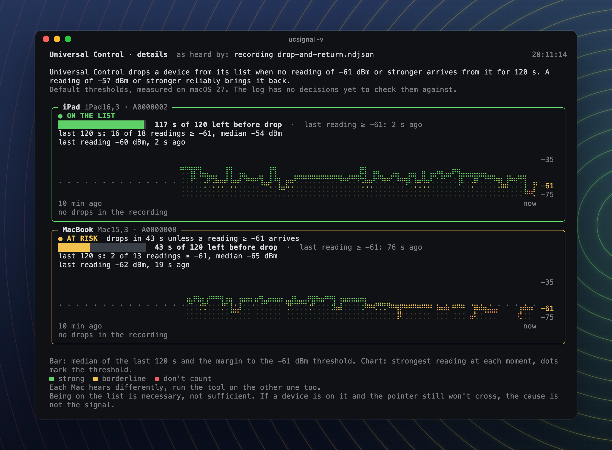
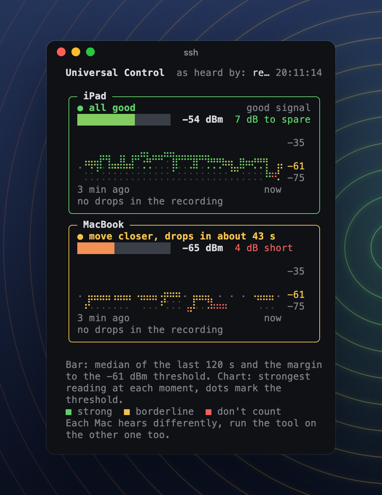

<p align="center"></p>

<h1 align="center">ucsignal</h1>

<p align="center">See how close Universal Control is to dropping your other Mac or iPad.</p>

<p align="center"><a href="https://github.com/marekp97/ucsignal/actions/workflows/ci.yml"></a> <a href="LICENSE"></a></p>

When the pointer stops crossing to your other Mac or iPad, the device has usually fallen below the Bluetooth signal level that Universal Control requires. `ucsignal` shows this live in the terminal: whether each device is on the Universal Control list, how much signal margin it has and how many seconds are left before macOS drops it.



## Install

Paste this into Terminal:

```
curl -fsSL https://raw.githubusercontent.com/marekp97/ucsignal/main/install.sh | sh
```

It puts one file in `/usr/local/bin`; delete that file to uninstall. With Go: `go install github.com/marekp97/ucsignal@latest`.

## Use

- `ucsignal` opens the live panel. Keys: `v` details, `l` language, `q` quit.
- `ucsignal -v` starts in the detail view.
- `ucsignal ipad` shows only devices with "ipad" in the name, model or ID.
- `ucsignal --plain` prints every reading and list change on its own line.
- `ucsignal --help` lists all options.

Run it on both Macs: each Mac decides on its own when to drop the other.

<p> </p>

To give devices readable names, list them in `~/.config/ucsignal/names`, one per line: the ID from the detail view, then the name (`A0000008 MacBook`).

The interface is available in 15 languages: press `l` in the panel or pass `--lang`. English and Polish are written by hand, the rest are machine-assisted; corrections are welcome.

## How Universal Control decides

- Every Bluetooth reading of -61 dBm or stronger restarts a 120-second timer.
- When the timer runs out, macOS drops the device and the pointer stops crossing.
- One reading of -57 dBm or stronger brings it back immediately.

`ucsignal` checks these values against your own log. Measurements and evidence: [docs/how-it-works.md](docs/how-it-works.md).

## Requirements

- macOS 13 or newer, tested on macOS 27.
- An administrator account, because reading the system log requires it.
- The log entries are not a public Apple API, so a macOS update can change them.

## Privacy

No network connections. `ucsignal` reads the local system log and stores a 12-hour cache in `~/Library/Caches/ucsignal` and the language choice in `~/.config/ucsignal`.

## Development

```
go test -race ./...
golangci-lint run
go run . --replay testdata/drop-and-return.ndjson --at 20:11:14 --names testdata/names
```

The last command replays the anonymized recording of a real drop and works without administrator rights. The tests compare the rendered screens with the files in `internal/ui/testdata`; after an intended change, `go test ./internal/ui -update` rewrites them.

The code is Go with [Bubble Tea](https://github.com/charmbracelet/bubbletea): `internal/logsrc` parses the log, `internal/engine` turns it into device state and `internal/ui` renders it.

## License

MIT. Not affiliated with or endorsed by Apple Inc.
